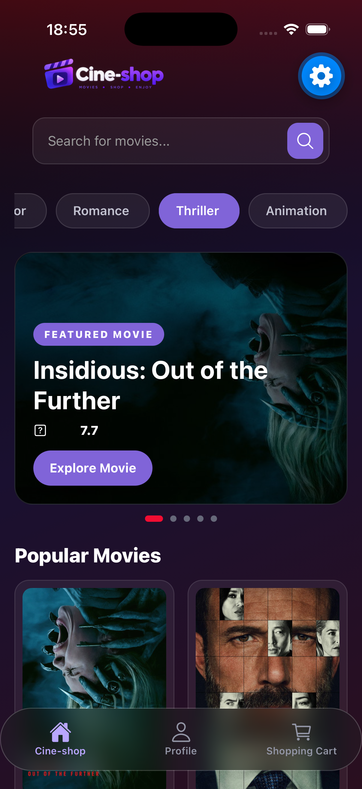
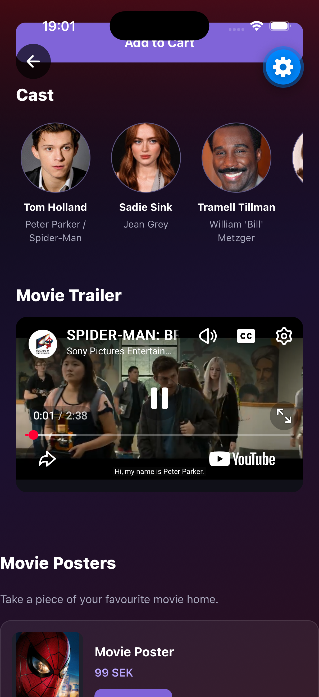
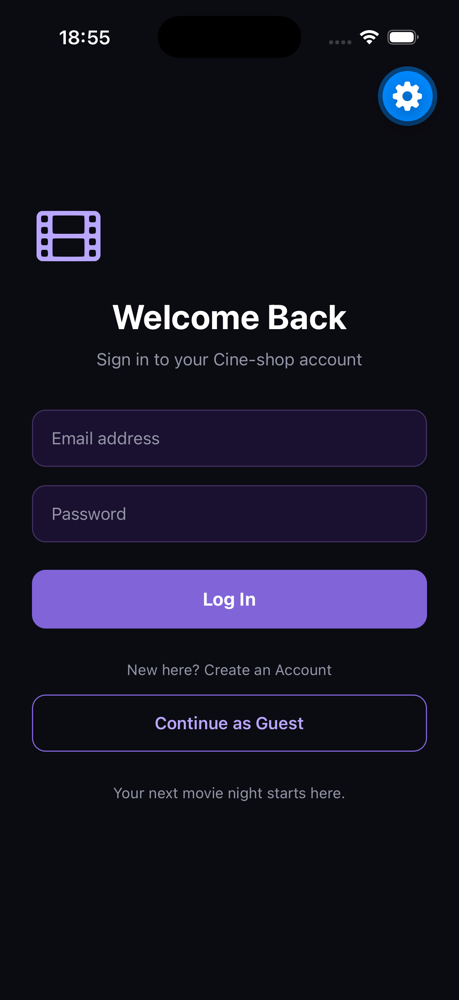
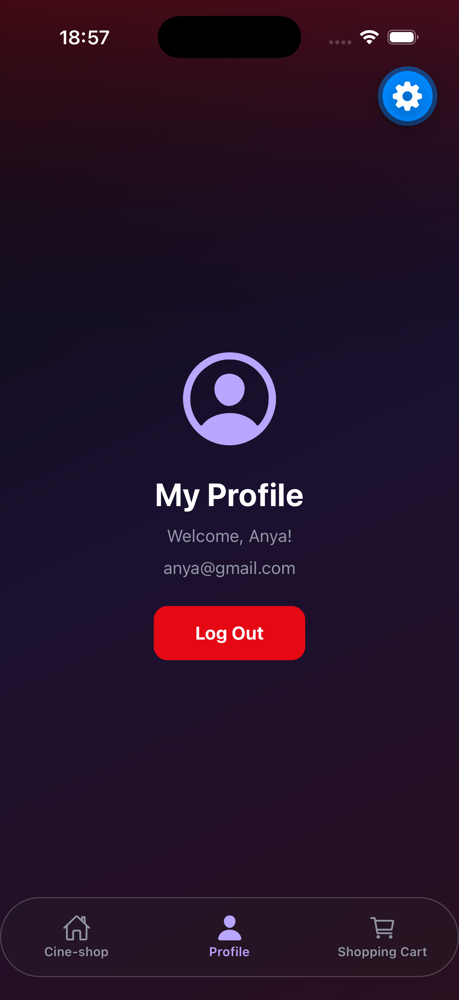
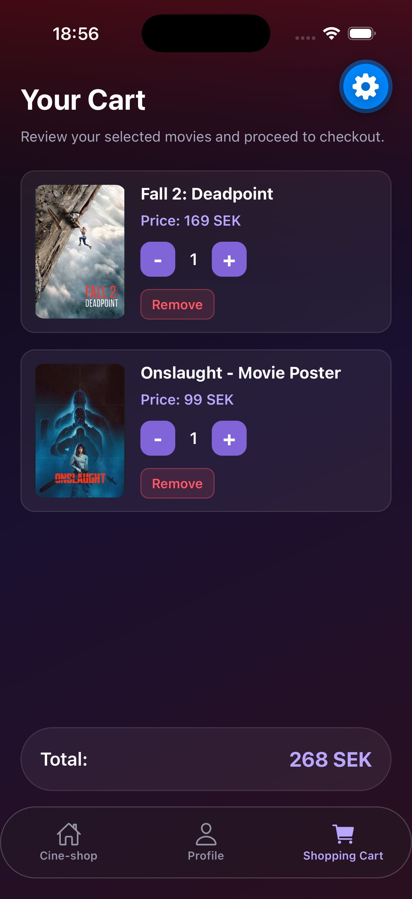

#  Cine-shop

**Cine-shop** is a movie-shopping mobile application built with React Native and Expo. It allows users to discover popular movies, explore film details, watch trailers, and manage their shopping cart through a cinematic user interface.

App Screenshots
<table>
  <tr>
    <td align="center">
      
       <strong>Home</strong>
    </td>
    <td align="center">
      
       <strong>Movie Details</strong>
    </td>
    <td align="center">
      
       <strong>Start</strong>
    </td>
  </tr>
  <tr>
    <td align="center">
      
       <strong>Profile</strong>
    </td>
    <td align="center">
      
       <strong>Cart</strong>
    </td>
    <td></td>
  </tr>
</table>

##  Features

- **Discover Movies:** Browse popular films using the TMDb API.
- **Search Movies:** Find films by title.
- **Movie Details:** View descriptions, ratings, cast information, and trailers.
- **User Authentication:** Register and log in using Firebase Authentication.
- **Shopping Cart:** Add movies, update quantities, and remove items.
- **Persistent Cart:** Store cart contents locally using AsyncStorage.
- **Separate User Carts:** Keep guest and signed-in users' cart data separate.
- **Bottom Navigation:** Navigate between Home, Profile, and Cart.
- **Cinematic Design:** Dark backgrounds, red accents, and a custom Cine-shop logo.

##  Technologies

- React Native
- Expo
- JavaScript
- React Navigation
- Redux Toolkit
- AsyncStorage
- Firebase Authentication
- TMDb API

##  Getting Started

### Prerequisites

Before running the project, install or prepare:

- Node.js and npm
- Expo Go on your phone or an iOS Simulator
- A TMDb API key
- A Firebase project with Email/Password Authentication enabled

### Installation

**1. Clone the repository**

git clone https://github.com/Urwa6/Cine-shop.git

**2. Navigate to the project folder**

cd Cine-shop

**3. Install dependencies**

npm install

**4. Configure environment variables**

Create a `.env` file in the project root and add your own API configuration:

EXPO_PUBLIC_TMDB_API_KEY=your_tmdb_api_key
EXPO_PUBLIC_FIREBASE_API_KEY=your_firebase_api_key
EXPO_PUBLIC_FIREBASE_AUTH_DOMAIN=your_firebase_auth_domain
EXPO_PUBLIC_FIREBASE_PROJECT_ID=your_firebase_project_id
EXPO_PUBLIC_FIREBASE_STORAGE_BUCKET=your_firebase_storage_bucket
EXPO_PUBLIC_FIREBASE_MESSAGING_SENDER_ID=your_messaging_sender_id
EXPO_PUBLIC_FIREBASE_APP_ID=your_firebase_app_id

Replace the example values with your own configuration.

**5. Start the application**

npx expo start

Scan the QR code with Expo Go, or press `i` to open the iOS Simulator.

## Environment Variables

The `.env` file contains local configuration and should not be committed to Git. Make sure it is included in `.gitignore`.

Variables beginning with `EXPO_PUBLIC_` are included in the client application bundle. They are not private secrets, so restrict API keys where supported.

##  Project Purpose

Cine-shop is an individual course project demonstrating mobile application development, external API integration, user authentication, state management, and persistent local storage.

##  Acknowledgements

- [TMDb](https://www.themoviedb.org/) — movie data and information.
- [Expo](https://expo.dev/) — mobile application development platform.
- [Firebase](https://firebase.google.com/) — user authentication.
